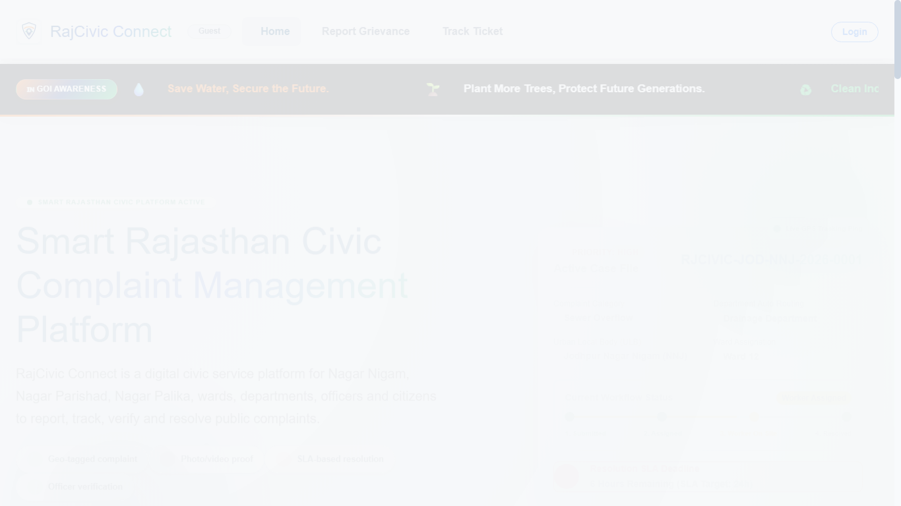
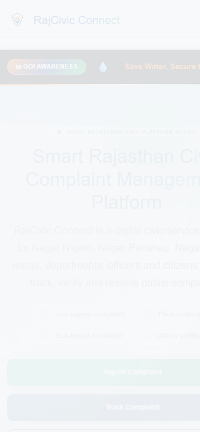

# Rajasthan Civic Connect

[](https://rajasthan-civic-connect.vercel.app)
[](https://civic-connect-api-bw8t.onrender.com/api/health)
[](https://aiven.io)
[](https://openjdk.org)
[](https://spring.io/projects/spring-boot)
[](https://react.dev)

Rajasthan Civic Connect is a production-grade, state-level citizen grievance redressal and municipal governance platform built for Rajasthan Urban Local Bodies (ULBs). It provides seamless, transparent complaint lifecycle tracking from citizen submission to department officer verification and resolution.

---

## Live Production Deployments

- **Frontend Application (Vercel):** [https://rajasthan-civic-connect.vercel.app](https://rajasthan-civic-connect.vercel.app)
- **REST API Backend (Render):** [https://civic-connect-api-bw8t.onrender.com](https://civic-connect-api-bw8t.onrender.com)
- **Health Check Status:** [https://civic-connect-api-bw8t.onrender.com/api/health](https://civic-connect-api-bw8t.onrender.com/api/health)
- **Managed Database:** Aiven Cloud MySQL 8.4 (SSL Enforced, TLS 1.3)

---

## Visual Preview

| Desktop Experience (1366 × 768) | Mobile Viewport (390 × 844) |
|:---:|:---:|
|  |  |

---

## Key Features

1. **Citizen Grievance Redressal:**
   - Lodge complaints with category, district, ULB, ward number, GPS geolocation, and photo evidence.
   - Automated category-to-department routing (Water, Sanitation, Public Works, Electricity, General).
   - In-progress draft autosave with persistent storage in MySQL.
   - Chronological ticket timeline tracking with real-time status transitions.
   - Post-resolution satisfaction ratings and feedback submission.

2. **Department Officer Workflow:**
   - Role-based department scoping (`users.department_id`); officers only see tickets belonging to their assigned department.
   - Department metrics dashboard: Total, Submitted, In Progress, Resolved, and Overdue SLA.
   - Status transitions (`InProgress`, `Resolved`, `Closed`) with official remarks and timeline audits.

3. **Administrator Governance Portal:**
   - State-wide aggregate performance metrics across all Rajasthan districts and ULBs.
   - Officer enrollment and department reassignment.
   - Full user directory management and municipal department administration.

4. **Automated SLA Timers:**
   - Dynamic SLA calculation based on grievance priority (Normal: 48h, High: 24h, Critical: 6h, Emergency: 2h).
   - Real-time SLA breach detection and escalation indicators.

---

## Architecture Overview

```text
┌────────────────────────────────────────────────────────┐
│                   Vercel CDN Edge                      │
│        React 19 + Vite 8 SPA (Client-Side State)       │
│        https://rajasthan-civic-connect.vercel.app      │
└───────────────────────────┬────────────────────────────┘
                            │ HTTPS / REST (JWT Bearer)
                            ▼
┌────────────────────────────────────────────────────────┐
│                   Render Web Service                   │
│        Spring Boot 3.5.11 / Java 21 (Eclipse Temurin)  │
│        Stateless Spring Security + Hibernate JPA       │
│        https://civic-connect-api-bw8t.onrender.com     │
└───────────────────────────┬────────────────────────────┘
                            │ SSL Mode: REQUIRED (TLS 1.3)
                            ▼
┌────────────────────────────────────────────────────────┐
│                   Aiven Cloud MySQL                    │
│        MySQL 8.4 Server (Managed Free-Tier Cluster)    │
│        Database: civic_connect (utf8mb4_unicode_ci)    │
└────────────────────────────────────────────────────────┘
```

---

## Technology Stack

### Backend
- **Language & Runtime:** Java 21 (Eclipse Temurin OpenJDK)
- **Framework:** Spring Boot 3.5.11
- **Security:** Spring Security (Stateless JWT token handling, BCrypt password hashing)
- **Database Access:** Spring Data JPA / Hibernate ORM
- **Database Driver:** MySQL Connector/J (`com.mysql:mysql-connector-j`)
- **Containerization:** Multi-stage Docker image with JVM memory tuning (`-XX:MaxRAMPercentage=65 -XX:+UseSerialGC`)
- **Build Tool:** Apache Maven 3.9 / Maven Wrapper (`mvnw`, `mvnw.cmd`)

### Frontend
- **Framework:** React 19 (`react`, `react-dom`)
- **Bundler & Tooling:** Vite 8 (`@vitejs/plugin-react`)
- **Styling:** Bootstrap 5, Bootstrap Icons, custom responsive CSS
- **Maps:** Leaflet 1.9, React-Leaflet 5
- **HTTP Client:** Native browser `fetch` with centralized `src/apiService.js`
- **Session:** JWT token persistence in `localStorage`

### Cloud Infrastructure
- **Frontend Hosting:** Vercel (Edge Network)
- **Backend Hosting:** Render (Docker Web Service)
- **Database Hosting:** Aiven (Managed MySQL Service)

---

## Repository Structure

```text
rajasthan-civic-connect/
├── README.md                           # Main repository documentation & guide
├── run-project.bat                     # Starts backend & frontend local development servers
├── stop-project.bat                    # Gracefully terminates local server processes
├── test-all.bat                        # Runs Maven integration tests & Vite production build
├── .gitignore                          # Git ignore definitions
├── backend/                            # Spring Boot 3.5 / Java 21 application
│   ├── README.md                       # Backend-specific architecture & setup
│   ├── pom.xml                         # Maven dependencies & build configuration
│   ├── Dockerfile                      # Production multi-stage Docker build
│   ├── mvnw / mvnw.cmd                 # Maven wrapper scripts
│   ├── .mvn/wrapper/                   # Maven wrapper binaries and configuration
│   ├── application-local.properties.example # Local configuration template
│   └── src/                            # Java source code and tests
├── frontend/                           # React 19 / Vite single-page application
│   ├── README.md                       # Frontend-specific architecture & setup
│   ├── package.json                    # Dependencies & npm scripts
│   ├── vite.config.js                  # Vite bundler configuration
│   ├── index.html                      # Entry HTML document
│   ├── .env.example                    # Environment variables template
│   ├── public/                         # Static assets and GeoJSON/ULB datasets
│   └── src/                            # React JSX components, plain CSS, apiService.js
├── database/                           # Database schema definitions
│   └── schema.sql                      # Complete MySQL database schema (8 entity tables)
└── docs/                               # Comprehensive project documentation
    ├── API_CONTRACT.md                 # Full REST API routes, schemas, and error codes
    ├── DEPLOYMENT.md                   # Cloud production deployment & environment guide
    └── screenshots/                    # Desktop and mobile application preview images
```

---

## Local Installation & Quickstart

### Prerequisites
- **Java:** JDK 21+ (`java -version`)
- **Node.js:** v18.0.0 or later (`node -v`)
- **MySQL:** MySQL Server 8.0+ running on `127.0.0.1:3306`

### 1. Database Setup
Execute the following commands in your MySQL client to create the database and user:

```sql
CREATE DATABASE IF NOT EXISTS civic_connect CHARACTER SET utf8mb4 COLLATE utf8mb4_unicode_ci;
CREATE DATABASE IF NOT EXISTS civic_connect_test CHARACTER SET utf8mb4 COLLATE utf8mb4_unicode_ci;
CREATE USER IF NOT EXISTS 'civic_app'@'127.0.0.1' IDENTIFIED BY 'civic_dev_password';
CREATE USER IF NOT EXISTS 'civic_app'@'localhost' IDENTIFIED BY 'civic_dev_password';
GRANT ALL PRIVILEGES ON civic_connect.* TO 'civic_app'@'127.0.0.1', 'civic_app'@'localhost';
GRANT ALL PRIVILEGES ON civic_connect_test.* TO 'civic_app'@'127.0.0.1', 'civic_app'@'localhost';
FLUSH PRIVILEGES;
```

### 2. Backend Configuration
Copy `backend/application-local.properties.example` to `backend/application-local.properties`:

```properties
MYSQL_HOST=127.0.0.1
MYSQL_PORT=3306
spring.datasource.url=jdbc:mysql://127.0.0.1:3306/civic_connect?useSSL=false&allowPublicKeyRetrieval=true&serverTimezone=UTC
spring.datasource.username=civic_app
spring.datasource.password=civic_dev_password
app.jwt.secret=<your_secure_256_bit_jwt_secret_key_here>
app.seed-demo-users=true
```

### 3. Frontend Configuration
Copy `frontend/.env.example` to `frontend/.env.local`:

```properties
VITE_API_BASE_URL=http://localhost:8080/api
```

### 4. Running Locally
Run both servers automatically:
```bat
run-project.bat
```
Or start them individually:
```powershell
# Terminal 1 - Backend
cd backend
.\mvnw.cmd spring-boot:run

# Terminal 2 - Frontend
cd frontend
npm install
npm run dev
```

- **Frontend Web UI:** `http://localhost:5173`
- **Backend API:** `http://localhost:8080/api`
- **Health Check:** `http://localhost:8080/api/health`

To stop local servers:
```bat
stop-project.bat
```

### 5. Running Automated Tests
```bat
test-all.bat
```
*(Runs backend JUnit integration tests and frontend Vite production bundling).*

---

## Demo Accounts (Development & Evaluation)

When `app.seed-demo-users=true` is enabled, the platform seeds standard demo credentials:

| Role | Username / Email | Password | Assigned Scope / Permissions |
|---|---|---|---|
| **Citizen** | `citizen@civic.local` | `Citizen@123` | Citizen portal: Lodge grievances, draft sync, live tracking |
| **Water Officer** | `officer@civic.local` | `Officer@123` | Scoped to Water Department tickets, SLA and status workflows |
| **Sanitation Officer** | `sanitation.officer@civic.local` | `Officer@123` | Scoped to Sanitation Department tickets |
| **Administrator** | `admin@civic.local` | `Admin@123` | Full governance: departments, officers, users, statistics |

> **Security Note:** Demo credentials are exclusively for evaluation. Never enter production passwords or sensitive personal data.

---

## API & Documentation References

- **REST API Contract:** Detailed request/response schemas and HTTP status codes are documented in [docs/API_CONTRACT.md](docs/API_CONTRACT.md).
- **Cloud Deployment Guide:** Step-by-step production deployment instructions, environment variable references, and operational considerations are documented in [docs/DEPLOYMENT.md](docs/DEPLOYMENT.md).
- **Backend Guide:** [backend/README.md](backend/README.md).
- **Frontend Guide:** [frontend/README.md](frontend/README.md).

---

## License

This project is developed for educational and portfolio demonstration purposes. All rights reserved.
