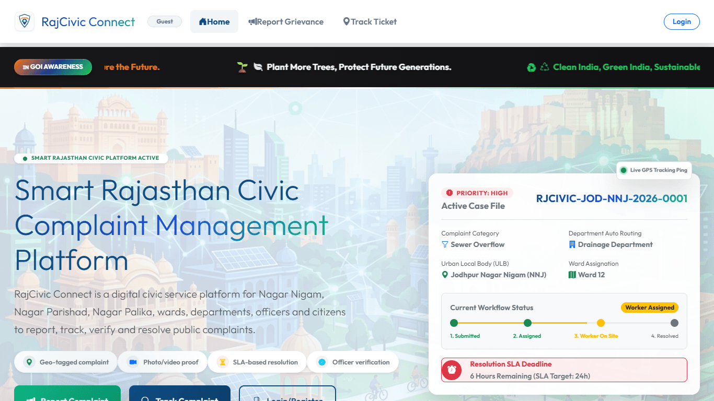
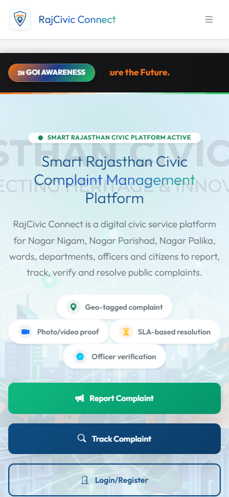
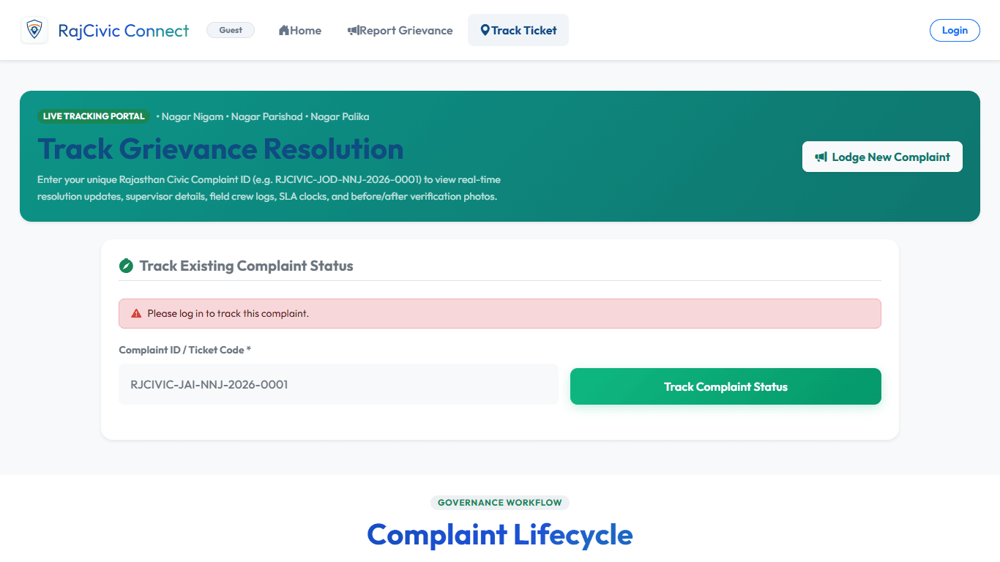
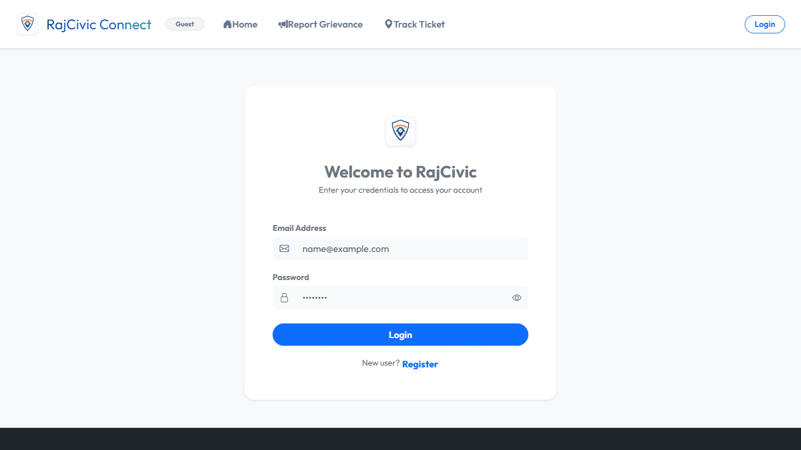

# Rajasthan Civic Connect

A modern citizen grievance redressal and municipal governance platform for Rajasthan Urban Local Bodies.

## About
Rajasthan Civic Connect bridges citizens and municipal administration across Rajasthan's Urban Local Bodies (ULBs). Citizens lodge grievances with verified municipal locations and photo evidence, while department officers (Water, Sanitation, etc.) triage, resolve, and audit complaints within time-bound SLAs. Administrators monitor state-wide municipal metrics and oversee department personnel.

## Live Links
- **Frontend Application:** [https://rajasthan-civic-connect.vercel.app](https://rajasthan-civic-connect.vercel.app)
- **Backend API Health:** [https://civic-connect-api-bw8t.onrender.com/api/health](https://civic-connect-api-bw8t.onrender.com/api/health)
- **GitHub Repository:** [https://github.com/Ramprasad-Prajapat/rajasthan-civic-connect](https://github.com/Ramprasad-Prajapat/rajasthan-civic-connect)
*(Note: Free-tier Render backend spins down on inactivity and may take ~60 seconds to cold start; free database may sleep).*

## Demo Logins
| Role | Email / Username | Password | Access Scope |
|---|---|---|---|
| **Citizen** | `citizen@civic.local` | `Citizen@123` | Lodge complaints, track status, view timeline, download e-slip |
| **Water Officer** | `officer@civic.local` | `Officer@123` | Scoped to Water Department grievances, status updates, SLA |
| **Sanitation Officer** | `sanitation.officer@civic.local` | `Officer@123` | Scoped to Sanitation Department grievances, status updates |
| **Administrator** | `admin@civic.local` | `Admin@123` | System-wide statistics, department management, officer provisioning |

## Key Features
- **Secure Authentication & Registration:** Citizen self-registration with 10-digit mobile validation and password visibility toggle.
- **Structured Grievance Submission:** Verified manual Rajasthan municipal dropdowns (District, ULB, Ward, Colony, Landmark) as the primary path, plus keyless Leaflet map picker (GPS capture removed).
- **Time-Bound SLA Engine:** Resolution deadlines derived directly from the backend API: Emergency (2h), Critical (6h), High Priority (12h), Normal Priority (48h).
- **Real-Time Ticket Tracking:** Instant tracking by ticket code with 4-stage lifecycle, live SLA countdown, and lazy photo loading.
- **Printable Acknowledgement:** Downloadable, printer-friendly formal grievance e-slip modal.
- **Department Officer Workflow:** Scoped grievance queue with inline status transitions, official remarks, and auto-refresh.
- **Administrator Governance Desk:** High-performance dashboard with state-wide metrics, officer assignment, department reassignment, and manual refresh.
- **Role-Wide Profile Management:** Editable name and 10-digit phone number with instant header sync and rollback on cancel.

## Visual Preview
| Desktop Home | Mobile Responsive | Ticket Tracking | Admin Governance Desk |
|:---:|:---:|:---:|:---:|
|  |  |  |  |

## Tech Stack
| Layer | Technologies | Deployment Host |
|---|---|---|
| **Frontend** | React 19, Vite 8, Bootstrap 5, Bootstrap Icons | Vercel (Edge CDN) |
| **Backend** | Java 21, Spring Boot 3.5, Spring Security, JWT, JPA / Hibernate | Render (Docker Web Service) |
| **Database** | MySQL 8.4 (Managed, SSL Enforced TLS 1.3) | Aiven Cloud |

## Quickstart (Local)
1. **Prerequisites:** Java 21 (`java -version`), Node.js 18+ (`node -v`), MySQL 8.0+ running on `127.0.0.1:3306`.
2. **Database:** Execute `CREATE DATABASE civic_connect; CREATE DATABASE civic_connect_test;`.
3. **Environment:** Copy `backend/application-local.properties.example` to `backend/application-local.properties` and `frontend/.env.example` to `frontend/.env.local`.
4. **Run Application:** Execute `run-project.bat` to launch backend and frontend servers together.
5. **Open UI:** Navigate to `http://localhost:5173` in your browser.
6. **Run Tests:** Execute `test-all.bat` to run backend JUnit integration suite and frontend production build.

## Deployment
- **Frontend (Vercel):** [https://rajasthan-civic-connect.vercel.app](https://rajasthan-civic-connect.vercel.app)
- **Backend (Render):** [https://civic-connect-api-bw8t.onrender.com](https://civic-connect-api-bw8t.onrender.com)
- **Health Check:** [https://civic-connect-api-bw8t.onrender.com/api/health](https://civic-connect-api-bw8t.onrender.com/api/health)
- **Database Provider:** Aiven Cloud MySQL (Enforced SSL TLS 1.3)
- Detailed cloud deployment instructions are documented in [docs/DEPLOYMENT.md](docs/DEPLOYMENT.md).

## Project Structure & API
```text
rajasthan-civic-connect/
├── backend/          # Spring Boot 3.5 REST API (Java 21, Spring Security, JWT, JPA)
├── frontend/         # React 19 SPA (Vite, Bootstrap 5, responsive citizen & officer UI)
├── database/         # MySQL relational schema (8 normalized entity tables)
├── docs/             # Technical architecture, API contracts, deployment guides, screenshots
├── run-project.bat   # Local orchestration script for development servers
└── test-all.bat      # Automated verification runner (JUnit + Vite build)
```
- **API Contract:** Full endpoint specifications and payload schemas in [docs/API_CONTRACT.md](docs/API_CONTRACT.md).
- **Author:** Ramprasad Prajapat ([GitHub Profile](https://github.com/Ramprasad-Prajapat)).
